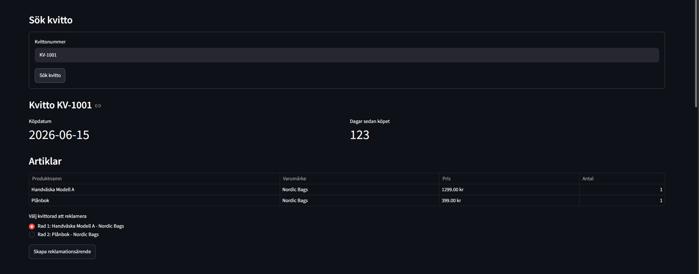
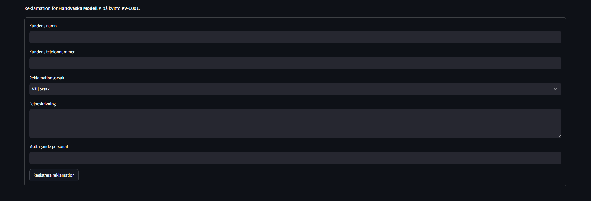
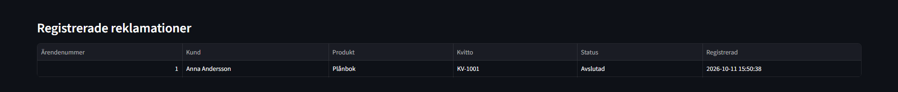
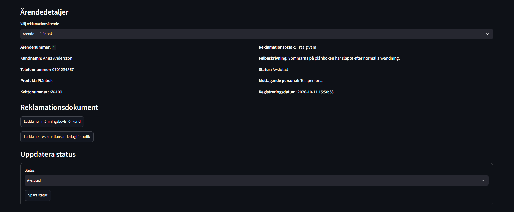
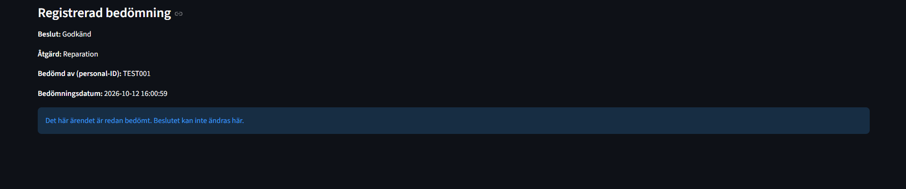
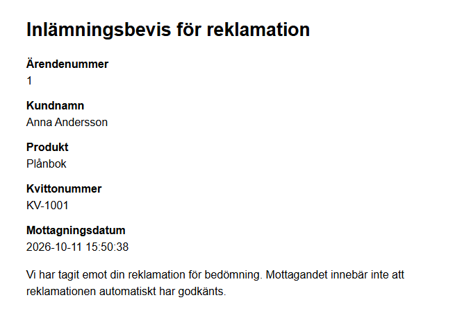
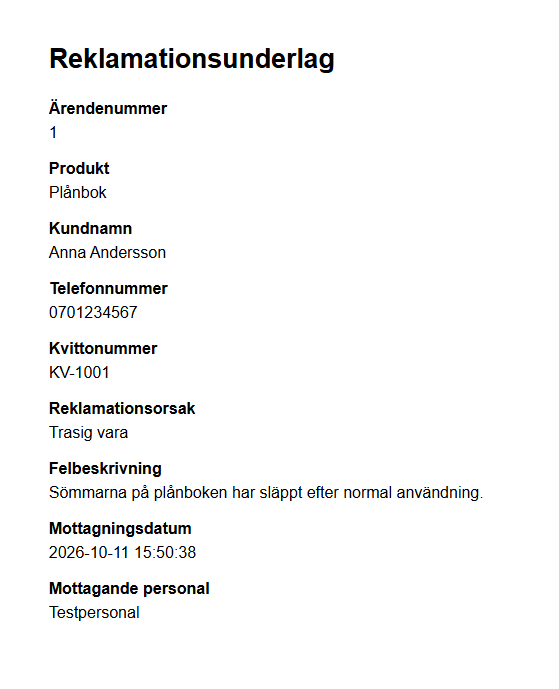

# Retail Claims Management System

## Overview

This independent portfolio project explores how retail product complaints (Swedish: *reklamationer*) could be handled digitally. The idea comes from firsthand retail experience, where complaints may involve paper forms and products kept in physical storage while awaiting assessment.

The prototype supports registering, assessing, tracking, and documenting complaints using simulated receipt data and a local SQLite database. It was developed by a Data Engineering student. This is not an official Åhléns project and is not an application used by Åhléns.

## Features

- Search simulated receipts and review their purchased items.
- Register a complaint against a receipt item with customer contact details, a reason, a description, and the receiving staff member.
- Prevent a second active complaint for the same item; an item can be claimed again after its previous complaint is closed.
- Review the complaint overview and open individual complaint details.
- Manually set a complaint status without enforcing a required sequence: *Registrerad* (Registered), *Under bedömning* (Under assessment), *Inlämnad för reparation* (Submitted for repair), *Redo att hämtas av kund* (Ready for customer pickup), or *Avslutad* (Closed).
- Record an assessment as approved or denied. Approved complaints can have an associated action: repair, refund, or replacement. The interface does not allow a saved assessment to be changed.
- Download an HTML customer receipt confirming that the complaint was received for assessment, and an HTML store complaint document. Both can be downloaded again from the complaint details.

## Screenshots

The user interface is in Swedish. Screenshots use fictional demo data.

### Receipt lookup

Search a simulated receipt and review its items.



### Complaint registration

Enter the customer and complaint details for a receipt item.



### Claims overview

Review registered complaints, including their current statuses.



### Complaint details

View the selected complaint and download its documents.



### Complaint assessment

Record an approval or denial and, for approved complaints, an action.



### Printable claim documents

<table>
  <tr>
    <td></td>
    <td></td>
  </tr>
  <tr>
    <td>Customer document confirming receipt of the item for assessment.</td>
    <td>Store document accompanying the product during processing.</td>
  </tr>
</table>

## Tech Stack

- **Python** contains the application logic and database/document helpers.
- **Streamlit** provides the interactive web interface.
- **SQLite** stores simulated receipts, products, receipt items, and complaint records in a local `reklamationssystem.db` file, created when the database is initialized during setup. The database file is ignored by Git.
- **SQL** is used through Python's built-in `sqlite3` module to create tables, retrieve records, and write complaint and assessment updates.

## Getting Started

Use a Python installation and a terminal. The commands below create an isolated environment, install the dependency declared by the project, initialize the demo receipt data, and start Streamlit. Run them from the repository root.

Create and activate a virtual environment:

**Windows PowerShell**

```powershell
python -m venv .venv
.\.venv\Scripts\Activate.ps1
```

**macOS or Linux**

```bash
python3 -m venv .venv
source .venv/bin/activate
```

Then, in the activated environment on either platform:

```bash
python -m pip install -r requirements.txt
python seed.py
streamlit run app.py
```

`seed.py` creates the database tables and inserts the simulated receipt and product data. It uses insert-if-missing logic, so running it again does not add duplicate demo receipt items. Example receipt numbers include `KV-1001` through `KV-1008`. The app database is stored alongside the Python files.

## Scope & Future Improvements

This is a prototype, not a production-ready system. Receipts are simulated and stored locally in SQLite. In a real retail environment, the intended direction would be integration with the existing point-of-sale (POS) system and printing receipts through the store's receipt printers. Here, staff instead download printable HTML documents and can print them from a browser.

Possible future work could include connecting to a retailer's POS and product data, integrating with its established printing workflow, and adding the access controls and operational safeguards needed for real customer data. None of these integrations is implemented in this prototype.
